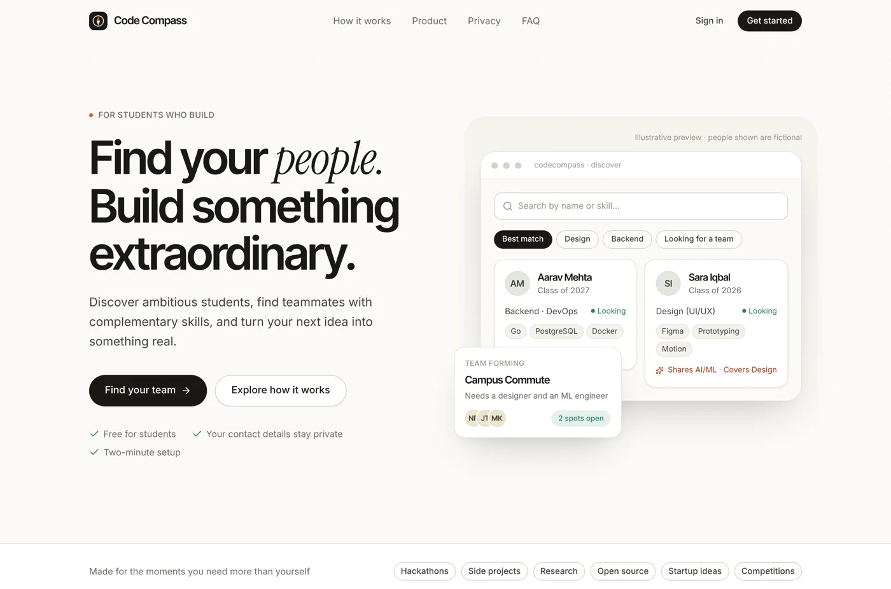
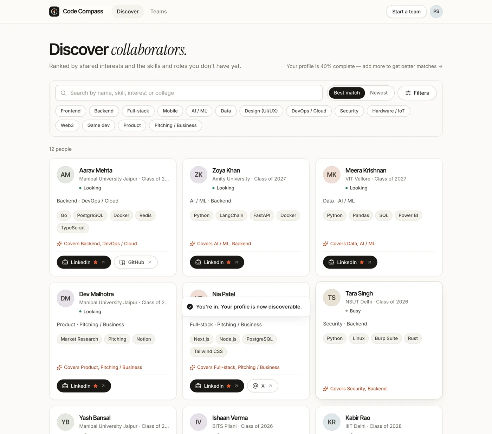
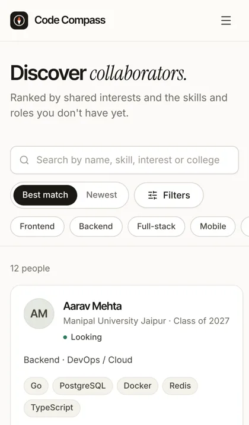

# Code Compass

**Find your people. Build something extraordinary.**

Code Compass helps students find teammates with complementary skills for hackathons, side projects and early
startup ideas. Build a profile, discover people ranked by how well they complement you, and form teams with clear
open roles.



> Version 2 is a full rebuild of the original Lovable/Supabase app (launched July 2025). Existing accounts and
> profiles are migrated with their original IDs and passwords — see [MIGRATION_REPORT.md](MIGRATION_REPORT.md).

---

## Features

| | |
|---|---|
| **Accounts** | Email + password sign-up, sign-in, sign-out, password reset by email, optional email confirmation, change password, sign out other devices, delete account. 30-day sessions in HttpOnly cookies. |
| **Profiles** | Name, photo, college, degree, graduation year, bio, skills, interests, preferred roles, hackathon interests, projects, availability, preferred contact method. Two-step onboarding asks only for the minimum. |
| **Links & privacy** | LinkedIn (first-class), X, GitHub, website, WhatsApp and email — each optional, each with its own visibility switch. Hidden values are filtered **in SQL** and never leave the server. |
| **Discovery** | Server-side search (name, skill, interest, college), filters (skills, interests, roles, availability, graduation year), pagination, and a *best match* ranking that explains itself ("Shares AI/ML · Covers Design"). |
| **Teams** | Create/edit/close/delete, open roles + needed skills, team size, request-to-join with a note, owner accepts/declines, remove members, leave, auto "full" status. Group chat links are shown to members only. |
| **Platform** | Rate limiting, input validation, security headers + CSP, health checks, graceful handling of Neon cold starts, responsive down to 320 px. |

<p>
  
  
</p>

## Stack

| Layer | Choice |
|---|---|
| Web | React 19, TypeScript, Vite 7, Tailwind CSS 4, Radix primitives (shadcn-style components), React Router 7, TanStack Query 5, Motion |
| API | [Hono](https://hono.dev) running as one Vercel serverless function (`api/index.ts`); the same app runs as a plain Node server locally |
| Auth | [Better Auth](https://better-auth.com) (email/password, scrypt for new passwords, bcrypt verification for migrated Supabase hashes) |
| Database | PostgreSQL on [Neon](https://neon.com), [Drizzle ORM](https://orm.drizzle.team) + versioned SQL migrations, `pg` driver (works with any Postgres) |
| Email | Gmail SMTP with an App Password (no domain needed), or [Resend](https://resend.com) once you own a domain |
| Hosting | Vercel (static site + function), Neon (database), GitHub (source) |

Architecture, data model and the privacy model are described in [ARCHITECTURE.md](ARCHITECTURE.md).

## Project structure

```
api/index.ts            Vercel function entry → server/app.ts
server/
  app.ts                Hono app: middleware, health, route mounting
  auth.ts               Better Auth configuration (bcrypt compat, rate limits, email hooks)
  env.ts                Validated environment variables
  db/schema.ts          Drizzle schema (auth + app tables)
  db/client.ts          Pooled pg connection
  routes/               me (profile, avatar) · people (discovery) · teams
  lib/                  http helpers/errors · privacy projection · rate limiter · mailer
shared/                 Code shared by web + API: constants, zod schemas, normalisers, tag canonicaliser, API types
src/                    React app (pages/, components/ui, components/app, lib/)
drizzle/                SQL migrations (generated + reviewed)
scripts/
  db-migrate.ts         Apply migrations
  migrate-legacy.ts     Supabase dump → new schema (idempotent, dry-run, report)
  verify-migration.ts   16 automated checks against the original dump
  seed-demo.ts          Fictional demo data for local development (local DBs only)
tests/
  api.test.ts           47 API integration tests against real Postgres
  e2e/flows.mjs         19 Playwright browser flows (desktop + iPhone)
docs/AUDIT.md           Phase-1 audit of the original app and backup
```

## Local development

Requirements: Node 22.x (pinned in package.json so Vercel uses the same major), PostgreSQL 15+ locally (or a Neon *development* branch).

```bash
npm install
cp .env.example .env               # then edit DATABASE_URL and BETTER_AUTH_SECRET
createdb cc_dev                    # or point DATABASE_URL at a Neon dev branch
npm run db:migrate
npm run demo:seed                  # optional: 12 fictional people + 3 teams (password: demo-password)
npm run dev                        # web on :5173, API on :3001 (proxied at /api)
```

Password-reset and confirmation emails are printed in the API terminal when `RESEND_API_KEY` is empty.

> **Don't put `NODE_ENV` in `.env`.** Vite reads `.env` too, and `NODE_ENV=development` there produces a
> development React build (3× larger, slower) even for `vite build`.

### Checks

```bash
npm run typecheck && npm run lint
npm test                           # API tests — needs a throwaway DB: createdb cc_test (or TEST_DATABASE_URL)
npm run build && npm run preview   # production build with the production CSP headers
npm run demo:reset && npm run test:e2e   # browser flows (needs API on :3001 against cc_demo + Playwright)
```

## Environment variables

See [.env.example](.env.example) for the full list with comments. Required: `DATABASE_URL`, `BETTER_AUTH_SECRET`,
`APP_URL`. Recommended for production: `RESEND_API_KEY`, `EMAIL_FROM`.

## Database & migrations

* Schema lives in `server/db/schema.ts`. After changing it: `npm run db:generate` → review the SQL in `drizzle/` → commit → `npm run db:migrate`.
* Migrations are forward-only and run explicitly (never automatically on deploy).
* Moving to another Postgres provider: `pg_dump` from Neon, restore anywhere, change `DATABASE_URL`. Nothing is Neon-specific except the connection string. See [DATABASE_BACKUP.md](DATABASE_BACKUP.md).

## Migrating the original Supabase data

```bash
npm run legacy:migrate -- --dump ./private/db_cluster.backup.gz --dry-run
npm run legacy:migrate -- --dump ./private/db_cluster.backup.gz            # local / staging
npm run legacy:verify  -- --dump ./private/db_cluster.backup.gz
```

Full procedure, results and limitations: [MIGRATION_REPORT.md](MIGRATION_REPORT.md).

## Deployment

Vercel + Neon, step by step: [DEPLOYMENT.md](DEPLOYMENT.md). Backups and restores: [DATABASE_BACKUP.md](DATABASE_BACKUP.md).

## Troubleshooting

| Symptom | Fix |
|---|---|
| First request after a quiet period takes a few seconds | Neon's free compute scales to zero after 5 minutes; the API retries and the UI shows loading states. Expected. |
| `Invalid environment configuration` on start | A required variable is missing or malformed; the message lists which (never the values). |
| Signed in but immediately signed out on production | `APP_URL` doesn't match the domain you're visiting, so cookies/origin checks fail. Set it to the exact public URL. |
| Password reset email never arrives | No email provider set (`SMTP_USER`/`SMTP_PASS` or `RESEND_API_KEY`), a wrong Gmail App Password, or (Resend) `EMAIL_FROM` isn't on a verified domain. Check the function logs for `[mail]`. Gmail sends at most ~500 emails a day. |
| `relation "users" does not exist` | Migrations haven't been applied to that database: `npm run db:migrate`. |
| `429 Too many attempts` while testing | Auth rate limits are active outside development. Wait a minute, or run with the default development `NODE_ENV`. |
| API returns 503 `db_unavailable` | Database unreachable (wrong URL, Neon suspended for quota, outage). Check `/api/health`. |

---

Built by Aryan Singh. Original launch: July 2025.
